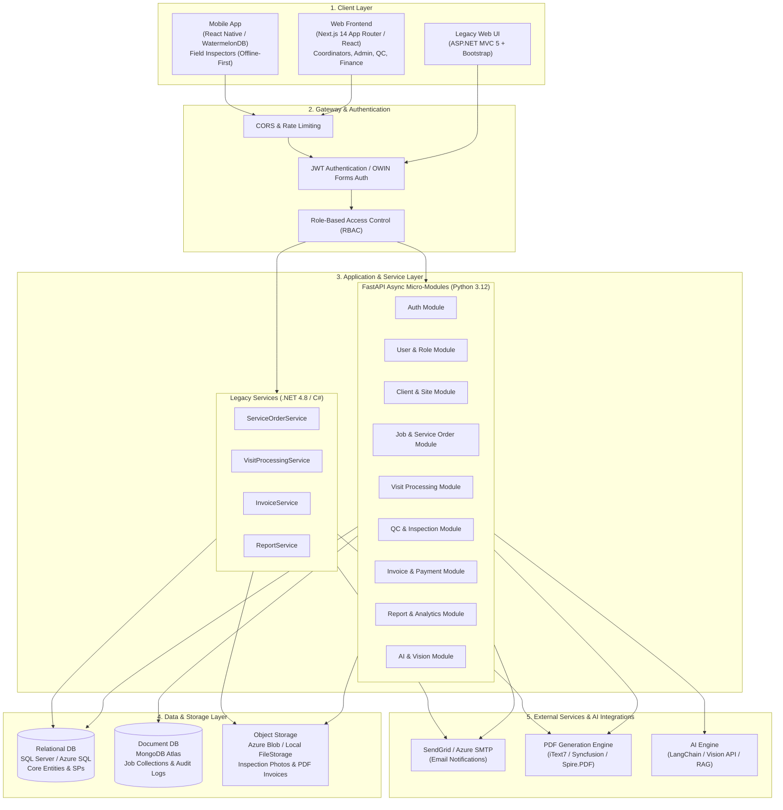
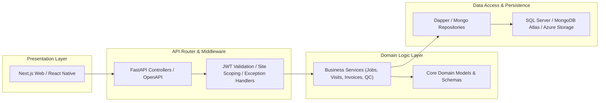
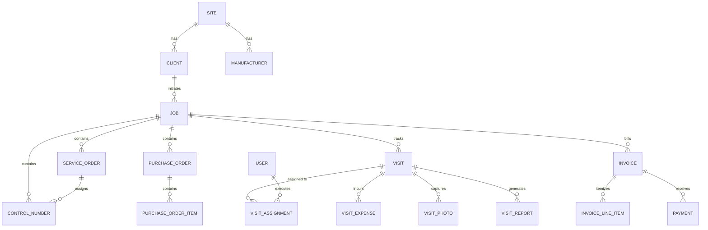
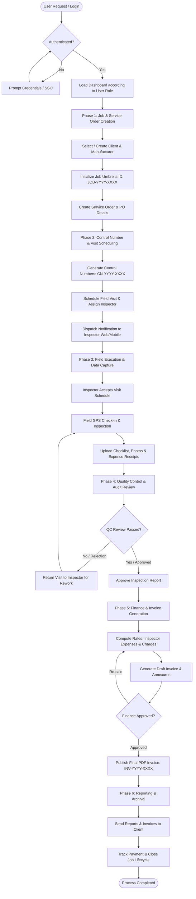
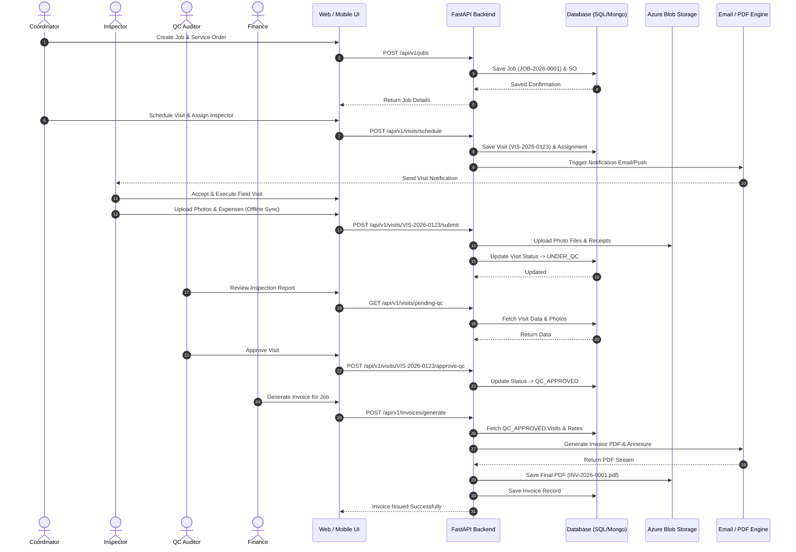
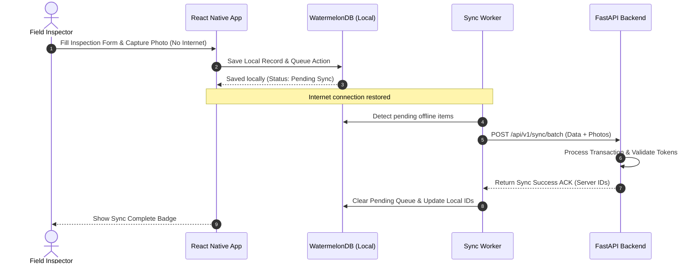

# IQE (Ideal Quality Engineers) - Architecture & End-to-End Flow Specification

This document provides a comprehensive technical reference for the **Architecture Flow (Arch Flow)** and **End-to-End Workflow (E2E Flow)** of the **IQE (Ideal Quality Engineers) Inspection Management System**. It covers the system architecture, dual-stack implementation (modern Next.js/FastAPI vs legacy ASP.NET MVC), entity data models, detailed lifecycle phases, sequence diagrams, and security matrix.

---

## 1. Executive Overview

IQE is an enterprise-grade Fieldglass-style Job & Inspection Management Platform designed to streamline third-party inspection (TPI), quality control (QC), site technician scheduling, field data/photo capture, financial billing, and automated reporting.

The system centers around a **Job ID (`job_id`) umbrella concept**—a single reference number linking all operational entities:
```
Client / Site ──▶ Job ID (Umbrella) ──▶ Service Order ──▶ Control Number ──▶ Visit Schedule
                                                                                 │
                                                                           Field Inspection
                                                                           (Docs, Photos, Expenses)
                                                                                 │
                                                                           Quality Control (QC)
                                                                                 │
                                                                           Finance Approval
                                                                                 │
                                                                           Invoice & Annexure
```

---

## 2. Architecture Flow (Arch Flow)

### 2.1 High-Level System Architecture



---

### 2.2 Dual-Stack Architecture Comparison

IQE supports both a modernized decoupled architecture and the existing legacy enterprise framework:

| Architecture Layer | Modern Stack (Target) | Legacy Stack (Operational) |
| :--- | :--- | :--- |
| **Frontend UI** | Next.js 14 (App Router, React 18, Tailwind CSS, TypeScript, Zustand) | ASP.NET MVC 5 (Razor, Bootstrap 5, jQuery, Dropzone.js, jsTree) |
| **Mobile Client** | React Native (WatermelonDB offline sync, Camera, Native GPS) | N/A (Responsive Web) |
| **Backend API** | FastAPI (Python 3.12, Async, Pydantic v2 schemas) | ASP.NET Web API 2 / MVC 5 Controllers (.NET Framework 4.8) |
| **Data Access** | Motor (Async Mongo), SQLAlchemy / asyncpg | Dapper ORM (Stored Procedures), Entity Framework 6 |
| **Primary Data Stores** | MongoDB Atlas + SQL Server | SQL Server (`IQEIMS_DEV` / `IQEIMS`) |
| **File Storage** | Azure Blob Storage + Local Disk | Azure Blob Storage + Physical `D:\IQEApp\FileStorage\` |
| **PDF Processing** | Python ReportLab / WeasyPrint / iText7 | iTextSharp, iText7, Syncfusion.Pdf, Spire.PDF |
| **Authentication** | Bearer JWT (HS256 / RS256) + RBAC Middleware | OWIN Katana Cookie Auth + Forms Authentication + CustomAuthorize Filter |
| **AI / Intelligence** | LangChain, OpenAI Vision / Gemini RAG pipelines | Built-in analytics & static reporting |

---

### 2.3 Layered Architecture Breakdown



---

## 3. Data Model & Entity Relationship (ER)

### 3.1 Umbrella Job Entity ID Structure

Every entity in IQE carries its own unique identifier and references the root `job_id` and `site_id` for tenant isolation.



### 3.2 Key Entity Identifier Standards

| Entity | ID Schema | Parent Reference | Description |
| :--- | :--- | :--- | :--- |
| **Site** | `SITE-XX` | — | Multi-tenant branch location |
| **Client** | `CLT-XXXX` | Site | Corporate client ordering inspections |
| **Manufacturer** | `MFR-XXXX` | Site | Vendor/Factory site being inspected |
| **User / Inspector** | `USR-XXXX` | Site | Staff member, coordinator, or field technician |
| **Job (Umbrella)** | `JOB-YYYY-XXXX` | Client | Single reference container for overall engagement |
| **Service Order** | `SO-YYYY-XXXX` | Job | Scope of inspection work contract |
| **Control Number** | `CN-YYYY-XXXX` | Job / SO | Individual tag/batch allocated for inspection |
| **Purchase Order** | `PO-YYYY-XXXX` | Job | Client PO billing reference |
| **Visit** | `VIS-YYYY-XXXX` | Job / CN | Scheduled field inspection event |
| **Inspection Photo** | `PHO-XXXX` | Visit | Photo evidence taken on site |
| **Visit Expense** | `EXP-XXXX` | Visit | Inspector travel, lodging, or meal claim |
| **Invoice** | `INV-YYYY-XXXX` | Job / Visit | Financial invoice issued to client |
| **Payment** | `PAY-YYYY-XXXX` | Invoice | Client payment settlement record |

---

## 4. End-to-End Workflow (E2E Flow)

### 4.1 Master End-to-End Process Flow



---

### 4.2 Detailed Phase Walkthrough

#### Phase 1: Authentication & Dashboard Initialization
1. **User Login**: User submits credentials via Next.js `/login` or mobile client.
2. **Token Generation**: FastAPI Auth service validates hashed password (Bcrypt), returns JWT Bearer token containing `user_id`, `role`, and `site_id`.
3. **Role Routing**:
   - **Coordinator**: Directed to Job Creation & Scheduling Console.
   - **Inspector**: Directed to Mobile Today's Visits & Offline Task Queue.
   - **QC Auditor**: Directed to Inspection Approval Queue.
   - **Finance**: Directed to Unbilled Visits & Invoice Management.

#### Phase 2: Job & Service Order (SO) Initialization
1. **Client Selection**: Select existing client (`client_id`) and client unit.
2. **Job Container Creation**: System creates root `Job` document (`job_id`: e.g. `JOB-2026-0001`).
3. **Service Order Setup**: Attach contract terms, scope of inspection, client PO (`po_id`), and manufacturer unit.
4. **Document Attachment**: Upload client spec sheets or standards to Azure Blob Storage / file storage.

#### Phase 3: Control Number Allocation & Visit Scheduling
1. **Control Number Generation**: Split Service Order into actionable control numbers (`control_number_id`).
2. **Inspector Matching**: Match technician competencies (`competency_id`), location proximity, and calendar availability.
3. **Visit Creation**: Schedule visit (`visit_id`), allocating estimated mandays, start date, and target execution site.
4. **Push Notification**: Automated email (SendGrid) and mobile push notification sent to assigned inspector.

#### Phase 4: Inspector Field Execution & Offline Data Sync
1. **Visit Acceptance**: Inspector confirms schedule via React Native app or mobile browser.
2. **GPS Check-In**: Inspector arrives at manufacturer site; app records GPS coordinates and timestamp.
3. **Inspection Data Capture**:
   - Executes inspection checklists.
   - Captures high-res photos (`photo_id`) with timestamps and watermark overlay.
   - Logs daily expenses (`expense_id`) and attaches receipt scans.
4. **Offline Resilience**: If offline, data is cached in WatermelonDB / local storage and auto-synced upon network restoration via background worker.

#### Phase 5: Quality Control (QC) & AI Verification
1. **QC Dispatch**: Submitted visit transitions to `UNDER_QC` status.
2. **AI Assistance (Optional)**: AI Vision engine scans photos for clarity, barcode correctness, and missing documentation.
3. **QC Review**: Auditor inspects report details, photos, and compliance findings.
4. **Approval / Revision**: If flaws exist, return to inspector with remarks; otherwise approve visit to `QC_APPROVED`.

#### Phase 6: Financial Billing & Invoice Generation
1. **Rate Calculation**: System fetches client billing rate card, inspector travel allowances, and extra hours.
2. **Consolidated Billing**: Group approved visits for a `job_id` into a unified invoice (`invoice_id`).
3. **Annexure & PDF Generation**: Engine compiles summary invoice, detailed line items, and inspection annexures into standard PDF.
4. **Client Dispatch**: Invoice mailed to client finance team; invoice status set to `ISSUED`.

#### Phase 7: Payment Tracking & Archival
1. **Payment Entry**: Record payment receipts (`payment_id`) against open invoices.
2. **Job Closure**: Once all visits are billed and cleared, set `job_id` status to `COMPLETED`.
3. **Data Archival**: Archive logs and photos to long-term storage for audit compliance.

---

## 5. Technical Sequence Diagrams

### 5.1 Service Order to Invoice End-to-End Sequence



---

### 5.2 Offline Mobile Synchronization Sequence



---

## 6. Security, Compliance & Data Access Control

### 6.1 Multi-Tenant Isolation
All queries strictly enforce site scoping using the `site_id` parameter to guarantee multi-tenant security:
$$\text{Filter} = (\text{Tenant Site ID} == \text{User Site ID}) \land (\text{Entity Site ID} == \text{Tenant Site ID})$$

### 6.2 Role-Based Access Control (RBAC) Matrix

| Module / Action | Admin | Coordinator | Inspector | QC Auditor | Finance | Client View |
| :--- | :---: | :---: | :---: | :---: | :---: | :---: |
| **Manage Users & Masters** | Full | Read | Read | Read | Read | None |
| **Create Job & Service Order** | Full | Full | Read | Read | Read | Read |
| **Schedule / Assign Visits** | Full | Full | View Assigned | Read | Read | Read |
| **Execute Visit & Upload Data** | Full | Edit Assigned | Full (Assigned) | View | View | None |
| **QC Review & Approval** | Full | View | View | Full | View | None |
| **Generate Invoice & Rates** | Full | View | None | View | Full | Read (Issued) |
| **Executive Reports** | Full | Full | Self Only | Full | Full | Client Only |

---

## 7. Document Summary & Reference Links

- **Main Codebase Path**: [IQEWorkSpace](file:///Users/avks/Desktop/Projects%20/IQE/iqe/IQEWorkSpace)
- **FastAPI Backend**: [backend/main.py](file:///Users/avks/Desktop/Projects%20/IQE/iqe/IQEWorkSpace/backend/main.py)
- **Web Frontend**: [apps/web/src/app](file:///Users/avks/Desktop/Projects%20/IQE/iqe/IQEWorkSpace/apps/web/src/app)
- **Architecture Diagram**: [architecture-diagram.md](file:///Users/avks/Desktop/Projects%20/IQE/iqe/IQEWorkSpace/architecture-diagram.md)
- **Workflow Overview**: [workflow-overview.md](file:///Users/avks/Desktop/Projects%20/IQE/iqe/IQEWorkSpace/workflow-overview.md)
- **Migration Plan**: [rn-fastapi-migration-plan.md](file:///Users/avks/Desktop/Projects%20/IQE/iqe/IQEWorkSpace/rn-fastapi-migration-plan.md)

---
*Document generated on: August 6, 2026*
